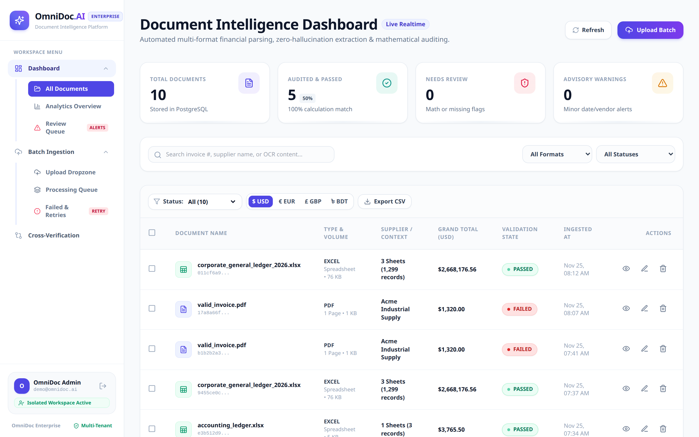
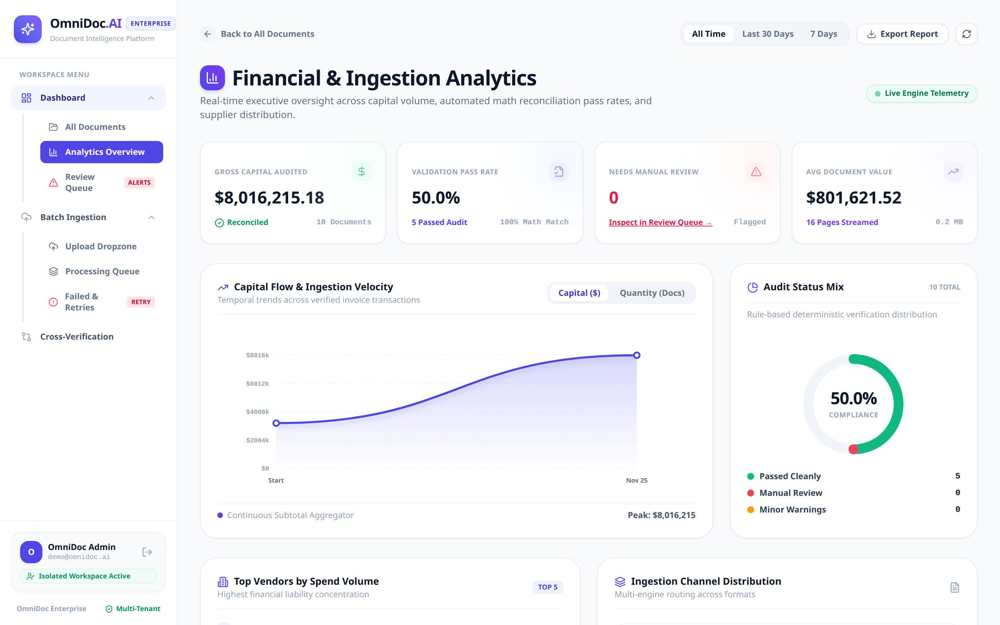
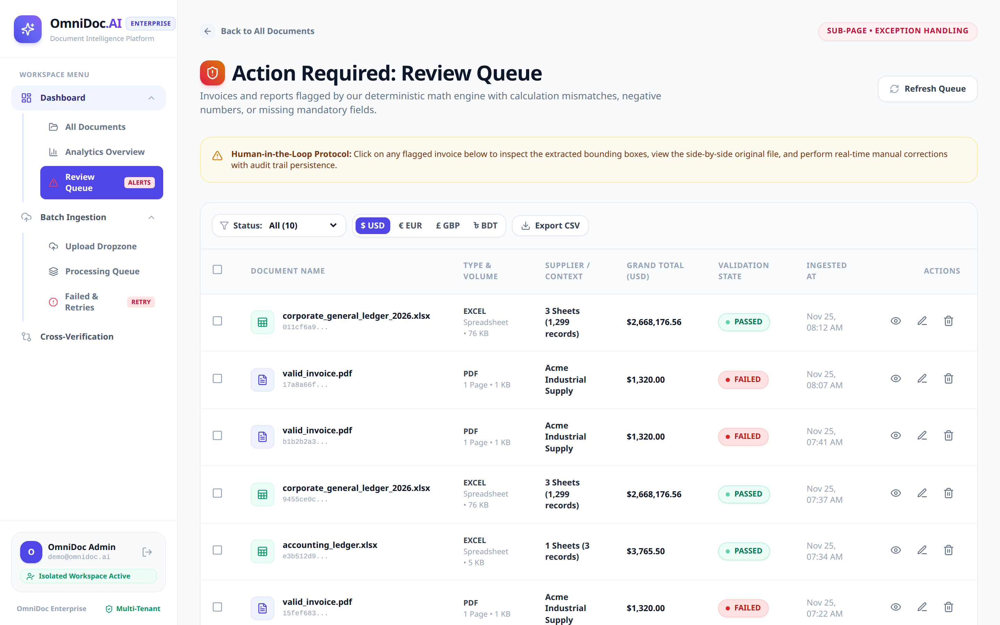
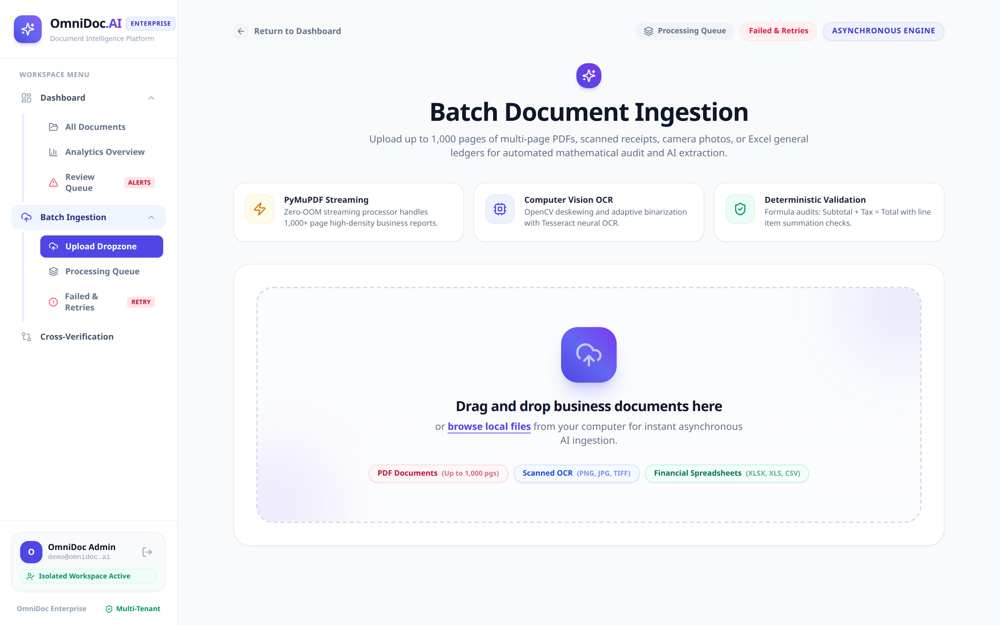
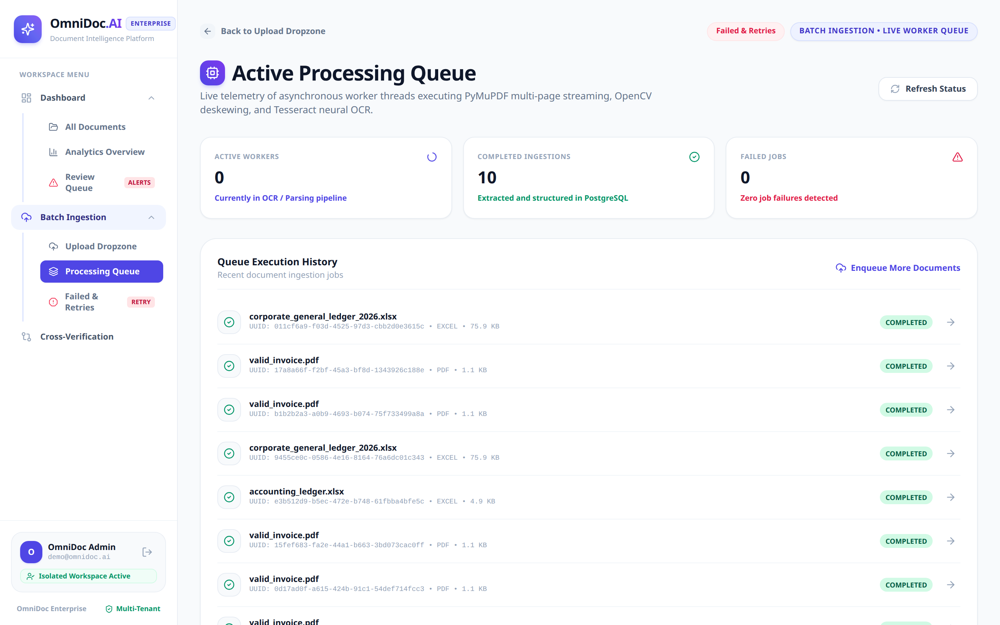

# OmniDoc-AI: Enterprise Application User Guide & Walkthrough

Welcome to the **OmniDoc-AI Document Intelligence System** user guide. This document provides an illustrated, step-by-step walkthrough of every module, sub-page, and core workflow within the platform.

---

## Table of Contents
1. [Authentication & Workspace Access](#1-authentication--workspace-access)
2. [Document Inventory & Corpus Management](#2-document-inventory--corpus-management)
3. [Executive Financial & Ingestion Analytics](#3-executive-financial--ingestion-analytics)
4. [Review Queue & Anomaly Resolution](#4-review-queue--anomaly-resolution)
5. [Batch Document Ingestion (Upload Dropzone)](#5-batch-document-ingestion-upload-dropzone)
6. [Live Worker Telemetry (Processing Queue)](#6-live-worker-telemetry-processing-queue)
7. [Error Diagnostics & Failed Retries Hub](#7-error-diagnostics--failed-retries-hub)
8. [Cross-Verification Hub (PDF-PDF & PDF-Excel)](#8-cross-verification-hub-pdf-pdf--pdf-excel)
9. [Interactive Financial Visualizer (Spreadsheet Intelligence)](#9-interactive-financial-visualizer-spreadsheet-intelligence)
10. [Document Split-Screen Viewer & Manual Correction](#10-document-split-screen-viewer--manual-correction)

---

## 1. Authentication & Workspace Access
- **Endpoint**: [`http://localhost:3000/login`](http://localhost:3000/login) / [`http://localhost:3000/signup`](http://localhost:3000/signup)

OmniDoc-AI features multi-tenant data isolation. Each authenticated user operates inside an isolated workspace where financial documents, audit trails, and validation rules are private to their tenant.

### Key Features:
- **Instant Tenant Sign-in**: Secure password hashing via Bcrypt and stateless JWT Bearer token generation.
- **One-Click Demo Credentials**: Pre-populated demo profiles allowing immediate evaluation without manual input.
- **Enterprise Workspace Routing**: Auto-redirects unauthenticated sessions via the global Next.js `AuthGuard`.

---

## 2. Document Inventory & Corpus Management
- **Endpoint**: [`http://localhost:3000/`](http://localhost:3000/)

The central dashboard presents a real-time ledger of all processed documents across the enterprise.

### Key Features:
- **Corpus Summary Cards**: Displays total documents, gross audited financial volume ($), and system-wide validation pass rate.
- **Real-Time Status Badges**:
  - `PASSED` (Green): 100% mathematical and business rule match.
  - `NEEDS_MANUAL_REVIEW` (Red): Mathematical discrepancy or missing mandatory fields.
  - `WARNING` (Yellow): Minor rounding tolerance delta (< $0.05).
- **Search & Filter**: Instant client-side filtering by document filename, vendor name, or status.

---

## 3. Executive Financial & Ingestion Analytics
- **Endpoint**: [`http://localhost:3000/analytics`](http://localhost:3000/analytics)

A financial reporting dashboard powered by custom SVG charts providing real-time capital oversight.

### Key Features:
- **Capital Flow Timeline (Smooth Area / Line Curve)**:
  - Visualizes daily/monthly transaction volume ($) and ingestion throughput.
  - View toggle between **Capital ($)** and **Quantity (Docs)** with interactive hover tooltips.
- **Audit Status Mix (Interactive Donut Chart)**:
  - Visual breakdown of verification compliance (`PASSED`, `WARNING`, `NEEDS_MANUAL_REVIEW`).
  - Displays overall compliance rate at the center of the ring.
- **Top Vendors by Spend**: Ranked horizontal distribution bars showing highest financial liabilities and document counts.
- **Ingestion Channel Stats**: Pipeline distribution across Digital PDFs, Multi-Sheet Excel Ledgers, and Scanned OCR Receipts.
- **Report Export**: One-click download of the complete analytics ledger as a formatted JSON audit report.

---

## 4. Review Queue & Anomaly Resolution
- **Endpoint**: [`http://localhost:3000/review-queue`](http://localhost:3000/review-queue)

The specialized audit queue isolates flagged documents that require human intervention.

### How to Resolve Review Items:
1. Identify documents flagged with `NEEDS_MANUAL_REVIEW`.
2. Click **Review Discrepancy** to open the split-screen comparison workbench.
3. Inspect the automated diagnostic message (e.g., *"Subtotal ($1,200.00) + Tax ($120.00) != Total ($1,400.00)"*).
4. Correct the values in the inline editor and click **Save & Re-Validate** to upgrade the status to `PASSED`.

---

## 5. Batch Document Ingestion (Upload Dropzone)
- **Endpoint**: [`http://localhost:3000/upload`](http://localhost:3000/upload)

The multi-format ingestion dropzone accepts enterprise batches up to 1,000+ pages per document.

### Supported Formats & Capabilities:
- **Digital PDFs**: Extracted via PyMuPDF in streamed memory chunks (25 pages/batch).
- **Scanned Images (JPG, PNG, TIFF)**: Deskewed, denoised, and binarized via OpenCV before Tesseract 5.5 OCR.
- **Multi-Sheet Spreadsheets (XLSX, XLS, CSV)**: Parsed with Pandas and OpenPyXL, preserving multi-tab relations.

---

## 6. Live Worker Telemetry (Processing Queue)
- **Endpoint**: [`http://localhost:3000/upload/queue`](http://localhost:3000/upload/queue)

Provides real-time visibility into asynchronous background worker threads executing multi-stage document processing.

### Telemetry Trackers:
- **Active Workers**: Number of background worker processes currently executing OCR or LLM extraction.
- **Pipeline Stages**: Real-time step progress (`Ingesting Stream` ➔ `Deskewing Image` ➔ `Extracting Line Items` ➔ `Validating Math`).
- **Auto-Refresh**: Live status polling every 5 seconds without manual page reloads.

---

## 7. Error Diagnostics & Failed Retries Hub
- **Endpoint**: [`http://localhost:3000/upload/failed`](http://localhost:3000/upload/failed)

Centralized failure recovery registry for damaged binaries, network timeouts, or unreadable document scans.

### Recovery Workflow:
- **Error Diagnostics**: Specific failure reasons displayed per document.
- **Single Retry**: Re-dispatches individual documents to the background worker queue.
- **Retry All**: Re-queues the entire failed batch in one click with exponential backoff handling.

---

## 8. Cross-Verification Hub (PDF-PDF & PDF-Excel)
- **Endpoint**: [`http://localhost:3000/verification`](http://localhost:3000/verification)

Automated two-way cross-document reconciliation engine to detect discrepancies between internal records and external invoices.

### Reconciliation Modes:
1. **PDF vs PDF (Invoice vs Purchase Order)**:
   - Validates that supplier name, purchase order number, line-item quantities, and totals match 100%.
2. **PDF vs Excel (Invoice vs General Ledger)**:
   - Cross-checks invoice grand totals against financial journal entries, ledger accounts, and bank statements.
3. **Discrepancy Matrix**:
   - Generates a field-by-field diff table highlighting matched values in green and mismatched values in red with a composite Match Score (0–100%).

---

## 9. Interactive Financial Visualizer (Spreadsheet Intelligence)
- **Endpoint**: [`http://localhost:3000/documents/[id]`](http://localhost:3000/documents/9455ce0c-0586-4e16-8164-76a6dc01c343)

When multi-sheet workbooks (e.g. `corporate_general_ledger_2026.xlsx`) are uploaded, OmniDoc-AI renders an interactive financial visualizer.

### Interactive Modules:
- **Departmental Spend Breakdown**: Dynamic bar chart showing allocation across Engineering, Operations, Marketing, and Legal.
- **Payment Status Distribution**: Visual split of `Paid`, `Pending`, and `Overdue` liabilities.
- **Cash-Flow Velocity Curve**: Time-series timeline tracking transaction volume and revenue impact.
- **Sheet Summaries**: Multi-tab selector displaying record counts, column types, and mathematical sums per sheet.

---

## 10. Document Split-Screen Viewer & Manual Correction
- **Endpoint**: [`http://localhost:3000/documents/[id]`](http://localhost:3000/documents/799b5126-5835-48f6-988c-7206ad27b557)

For invoices and receipts, the platform offers a side-by-side inspection view.

### Inspection Panels:
- **Left Panel (Original Document)**: Embedded PDF viewer or high-resolution zoomable image canvas.
- **Right Panel (Extracted Intelligence)**:
  - Header data (Invoice Number, Date, Supplier Name, Customer Name, Currency).
  - Extracted Line Items table with Quantity, Unit Price, and Line Amount.
  - Real-time mathematical audit summary showing Subtotal, Tax, and Grand Total balance.
  - **Inline Correction Mode**: Edit any disputed field and trigger instant backend re-validation.

---

*OmniDoc-AI Enterprise • Multi-Format Document Intelligence Platform*
