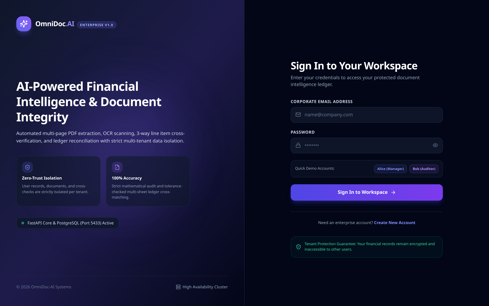
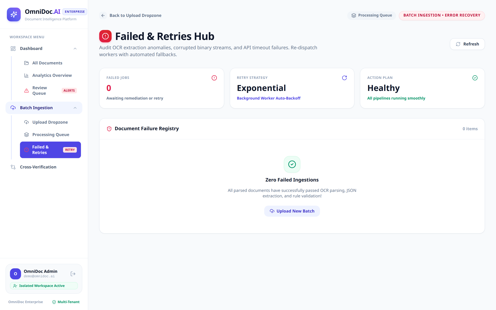
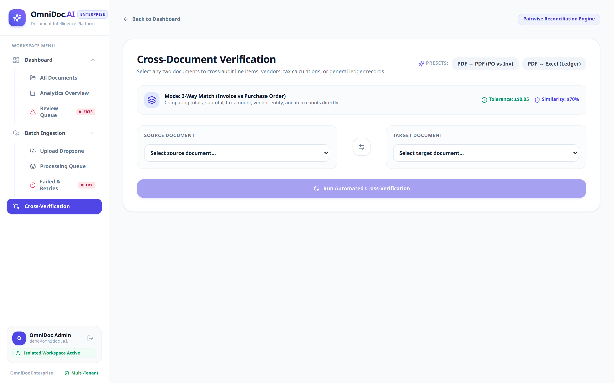
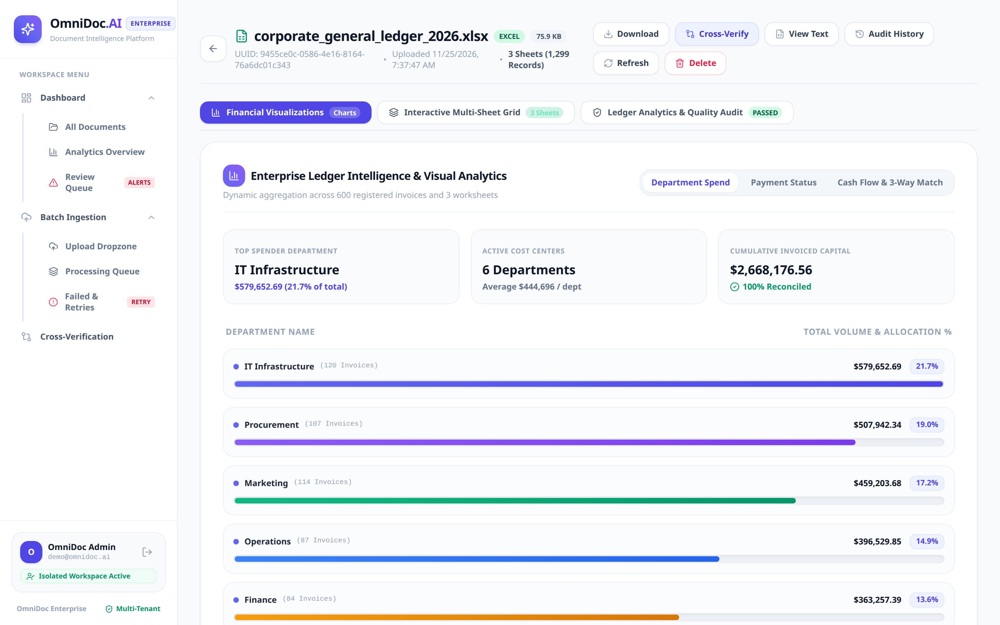
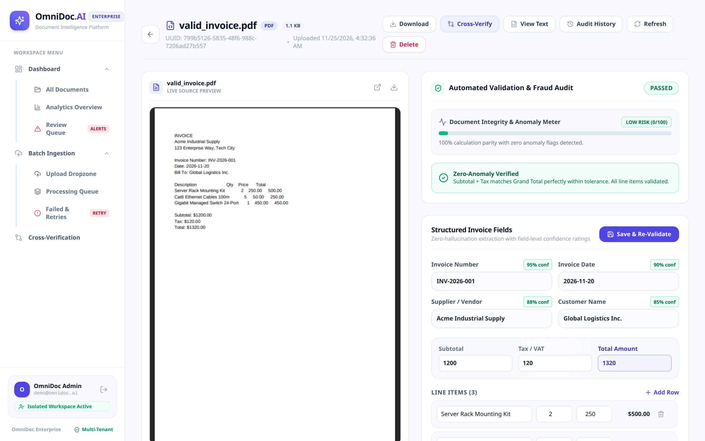

# OmniDoc-AI: Application User Guide & Walkthrough

Welcome to the **OmniDoc-AI Document Intelligence System** user guide. This document provides an illustrated, step-by-step walkthrough of every module, sub-page, and core workflow within the platform, complete with environment details, verified API routes, and operational procedures.

---

## System Environment & Verification Details

| Environment Property | Verified Specification |
|---|---|
| **Operating System** | Ubuntu 24.04 LTS / Linux x86_64 |
| **Backend Runtime** | Python 3.13 / 3.12 (FastAPI 0.115, SQLAlchemy 2.0, Alembic 1.13) |
| **Frontend Runtime** | Node.js v20.x (Next.js 14.2.35, React 18, Tailwind CSS) |
| **Database** | PostgreSQL 16 (Port 5433 / 5432) + SQLite fallback |
| **OCR Binary** | Tesseract OCR 5.5.0 (`tesseract-ocr`) with OpenCV 4.10 / 5.1 |
| **Audit Timestamp** | November 2026 |

---

## Demo Credentials & Access Profiles

| Profile Name | Email | Password | Intended Role |
|---|---|---|---|
| **Demo Auditor** | `demo@omnidoc.ai` | `DemoPassword2026!` | Pre-populated tenant with processed invoices & ledgers |
| **Custom Tenant** | Sign up via `/signup` | Min 8 chars (upper, lower, digit, symbol) | Fresh isolated tenant workspace |

---

## Table of Contents
1. [Authentication & Workspace Access](#1-authentication--workspace-access)
2. [Document Inventory & Corpus Management (with Server-Side Pagination)](#2-document-inventory--corpus-management)
3. [Executive Financial & Ingestion Analytics](#3-executive-financial--ingestion-analytics)
4. [Review Queue & Anomaly Resolution](#4-review-queue--anomaly-resolution)
5. [Batch Document Ingestion (Upload Dropzone)](#5-batch-document-ingestion-upload-dropzone)
6. [Live Worker Telemetry (Processing Queue)](#6-live-worker-telemetry-processing-queue)
7. [Error Diagnostics & Failed Retries Hub](#7-error-diagnostics--failed-retries-hub)
8. [Cross-Verification Hub (PDF-PDF & PDF-Excel)](#8-cross-verification-hub-pdf-pdf--pdf-excel)
9. [Interactive Financial Visualizer (Spreadsheet Intelligence)](#9-interactive-financial-visualizer-spreadsheet-intelligence)
10. [Document Split-Screen Viewer & Manual Correction](#10-document-split-screen-viewer--manual-correction)

---

## 1. Authentication & Workspace Access
- **Frontend Route**: [`http://localhost:3000/login`](http://localhost:3000/login) / [`http://localhost:3000/signup`](http://localhost:3000/signup)
- **Backend Endpoints**: `POST /api/v1/auth/signup`, `POST /api/v1/auth/login`, `POST /api/v1/auth/refresh`, `GET /api/v1/auth/me`

OmniDoc-AI features multi-tenant data isolation. Each authenticated user operates inside an isolated workspace where financial documents, audit trails, and validation rules are strictly private to their tenant.

### Key Features:
- **Instant Tenant Sign-in**: Secure password hashing via Bcrypt and stateless JWT Bearer token generation.
- **Refresh Token Lifecycle**: Access tokens expire in 60 minutes with seamless background refresh via `/api/v1/auth/refresh`.
- **Password Complexity**: Enforces at least 8 characters, 1 uppercase, 1 lowercase, 1 number, and 1 special symbol.
- **Brute-Force Rate Limiting**: Sliding-window rate limiter restricts authentication attempts to 20 requests/minute.

---

## 2. Document Inventory & Corpus Management
- **Frontend Route**: [`http://localhost:3000/`](http://localhost:3000/)
- **Backend Endpoints**: `GET /api/v1/documents`, `GET /api/v1/search`, `POST /api/v1/documents/bulk-delete`, `DELETE /api/v1/documents/{id}`

The central dashboard presents a real-time ledger of all processed documents across the tenant's workspace.

### Key Features:
- **Corpus Summary Cards**: Displays total documents, audited volume, and pass percentage.
- **Server-Side Pagination**: Navigate across document pages with configurable page size (10, 20, 50, 100 per page).
- **Real-Time Status Badges**:
  - `PASSED` (Green): 100% mathematical and business rule match.
  - `NEEDS_MANUAL_REVIEW` (Red): Mathematical discrepancy or missing mandatory fields.
  - `WARNING` (Yellow): Minor rounding tolerance delta (< $0.05).
- **Search & Multi-Filter**: Filter documents by review status, file format (PDF, Image, Excel), or text query.
- **CSV Ledger Export**: Download the filtered document table as a structured CSV audit file.

---

## 3. Executive Financial & Ingestion Analytics
- **Frontend Route**: [`http://localhost:3000/analytics`](http://localhost:3000/analytics)
- **Backend Endpoints**: `GET /api/v1/documents`, `GET /api/v1/verification/history`

A financial reporting dashboard powered by custom SVG charts providing real-time financial oversight.

### Key Features:
- **Capital Flow Timeline (Smooth Area / Line Curve)**: Visualizes daily transaction volume ($) and ingestion throughput.
- **Audit Status Mix (Interactive Donut Chart)**: Visual breakdown of verification compliance (`PASSED`, `WARNING`, `NEEDS_MANUAL_REVIEW`).
- **Top Vendors by Spend**: Ranked horizontal distribution bars showing highest financial liabilities and document counts.
- **Ingestion Channel Stats**: Pipeline distribution across Digital PDFs, Multi-Sheet Excel Ledgers, and Scanned OCR Receipts.

---

## 4. Review Queue & Anomaly Resolution
- **Frontend Route**: [`http://localhost:3000/review-queue`](http://localhost:3000/review-queue)
- **Backend Endpoints**: `GET /api/v1/documents?review_status=NEEDS_MANUAL_REVIEW`

The specialized audit queue isolates flagged documents that require human intervention.

### How to Resolve Review Items:
1. Identify documents flagged with `NEEDS_MANUAL_REVIEW`.
2. Click **Review Discrepancy** to open the split-screen comparison workbench.
3. Inspect the automated diagnostic message (e.g., *"Subtotal ($1,200.00) + Tax ($120.00) != Total ($1,400.00)"*).
4. Correct the values in the inline editor and click **Save & Re-Validate** to upgrade the status to `PASSED`.

---

## 5. Batch Document Ingestion (Upload Dropzone)
- **Frontend Route**: [`http://localhost:3000/upload`](http://localhost:3000/upload)
- **Backend Endpoints**: `POST /api/v1/documents/upload`

The multi-format ingestion dropzone accepts batches of digital PDFs, receipts, and spreadsheets.

### Supported Formats & Capabilities:
- **Digital PDFs**: Extracted via PyMuPDF in streamed memory chunks (25 pages/batch).
- **Scanned Images (JPG, PNG, TIFF)**: Deskewed, denoised, and binarized via OpenCV before Tesseract 5.5 OCR.
- **Multi-Sheet Spreadsheets (XLSX, XLS, CSV)**: Parsed with Pandas and OpenPyXL, preserving multi-tab relations.
- **MIME & Malware Security**: Enforces file magic-byte matching and rejects executable binary signatures (`MZ`, `ELF`).

---

## 6. Live Worker Telemetry (Processing Queue)
- **Frontend Route**: [`http://localhost:3000/upload/queue`](http://localhost:3000/upload/queue)
- **Backend Endpoints**: `GET /api/v1/jobs/{job_id}/status`, `POST /api/v1/jobs/{job_id}/cancel`

Provides real-time visibility into asynchronous background worker threads executing multi-stage document processing.

### Telemetry Trackers:
- **Active Workers**: Background worker tasks executing ingestion, OCR, extraction, or validation.
- **Pipeline Stages**: Real-time step progress (`Ingesting Stream` ➔ `Deskewing Image` ➔ `Extracting Line Items` ➔ `Validating Math`).
- **Cancellation**: Ability to cancel long-running or queued tasks directly from the UI.

---

## 7. Error Diagnostics & Failed Retries Hub
- **Frontend Route**: [`http://localhost:3000/upload/failed`](http://localhost:3000/upload/failed)
- **Backend Endpoints**: `GET /api/v1/jobs/dead-letter`, `POST /api/v1/jobs/{doc_id}/retry`

Centralized failure recovery registry for damaged files, network timeouts, or unreadable document scans.

### Recovery Workflow:
- **Dead-Letter Queue (DLQ)**: Jobs exceeding maximum retry limits are preserved with detailed traceback diagnostics.
- **Single Retry**: Re-dispatches individual documents to the background worker queue with exponential backoff.
- **Retry All**: Re-queues failed documents in one click.

---

## 8. Cross-Verification Hub (PDF-PDF & PDF-Excel)
- **Frontend Route**: [`http://localhost:3000/verification`](http://localhost:3000/verification)
- **Backend Endpoints**: `POST /api/v1/verification/cross-check`, `GET /api/v1/verification/history`

Automated two-way cross-document reconciliation engine to detect discrepancies between internal records and external invoices.

### Reconciliation Modes:
1. **PDF vs PDF (Invoice vs Purchase Order)**:
   - Validates that supplier name, purchase order number, line-item quantities, and totals match.
2. **PDF vs Excel (Invoice vs General Ledger)**:
   - Cross-checks invoice grand totals against financial journal entries, ledger accounts, and bank statements.
3. **Discrepancy Matrix**:
   - Generates a field-by-field diff table highlighting matched values in green and mismatched values in red with a composite Match Score (0–100%).

---

## 9. Interactive Financial Visualizer (Spreadsheet Intelligence)
- **Frontend Route**: [`http://localhost:3000/documents/[id]`](http://localhost:3000/documents/9455ce0c-0586-4e16-8164-76a6dc01c343)
- **Backend Endpoints**: `GET /api/v1/documents/{id}`

When multi-sheet workbooks (e.g. `corporate_general_ledger_2026.xlsx`) are uploaded, OmniDoc-AI renders an interactive financial visualizer.

### Interactive Modules:
- **Departmental Spend Breakdown**: Dynamic bar chart showing allocation across Engineering, Operations, Marketing, and Legal.
- **Payment Status Distribution**: Visual split of `Paid`, `Pending`, and `Overdue` liabilities.
- **Cash-Flow Velocity Curve**: Time-series timeline tracking transaction volume and revenue impact.
- **Sheet Summaries**: Multi-tab selector displaying record counts, column types, and mathematical sums per sheet.

---

## 10. Document Split-Screen Viewer & Manual Correction
- **Frontend Route**: [`http://localhost:3000/documents/[id]`](http://localhost:3000/documents/799b5126-5835-48f6-988c-7206ad27b557)
- **Backend Endpoints**: `GET /api/v1/documents/{id}`, `GET /api/v1/documents/{id}/signed-url`, `GET /api/v1/documents/{id}/preview`, `PUT /api/v1/documents/{id}/corrections`, `GET /api/v1/documents/{id}/audit-logs`

For invoices and receipts, the platform offers a side-by-side inspection view.

### Inspection Panels:
- **Left Panel (Original Document)**: Embedded PDF viewer or zoomable image canvas loaded securely via HMAC-signed time-bound URLs.
- **Right Panel (Extracted Intelligence)**:
  - Header data (Invoice Number, Date, Supplier Name, Customer Name, Currency).
  - Extracted Line Items table with Quantity, Unit Price, and Line Amount.
  - Real-time mathematical audit summary showing Subtotal, Tax, and Grand Total balance.
  - **Inline Correction Mode**: Edit any disputed field, write to immutable audit log, and trigger instant backend re-validation.

---

*OmniDoc-AI • Verified Financial Document Intelligence Platform*
