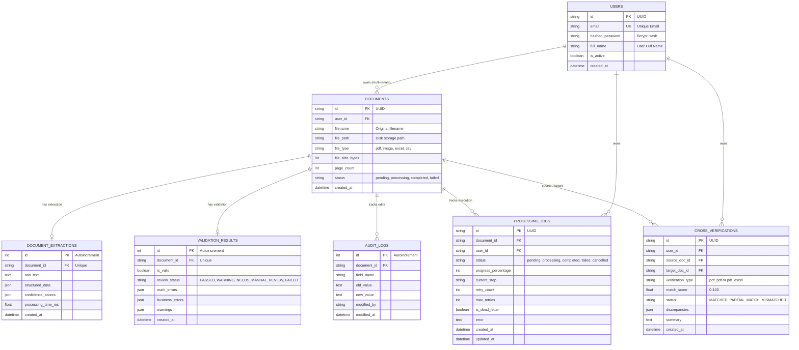

# OmniDoc-AI: Production-Grade Document Intelligence System

[](https://omnidoc-frontend-mauve.vercel.app)
[](https://omnidoc-ai-backend-9oin.onrender.com/docs)
[](https://neon.tech)

[](https://fastapi.tiangolo.com)
[](https://nextjs.org)
[](https://neon.tech)
[-success?style=flat-square&logo=pytest)](https://docs.pytest.org)
[-success?style=flat-square&logo=vitest)](Frontend)
[](Backend)
[](APP_USER_GUIDE.md)
[](LICENSE)

---

### 🌐 Live Production Deployments

| Component | Platform | URL | Health / Docs |
|---|---|---|---|
| **Frontend Web App** | **Vercel** | [https://omnidoc-frontend-mauve.vercel.app](https://omnidoc-frontend-mauve.vercel.app) | [Health Probe](https://omnidoc-frontend-mauve.vercel.app/api/health) |
| **FastAPI Backend** | **Render (Docker)** | [https://omnidoc-ai-backend-9oin.onrender.com](https://omnidoc-ai-backend-9oin.onrender.com) | [Swagger UI Docs](https://omnidoc-ai-backend-9oin.onrender.com/docs) |
| **Serverless Database** | **Neon (AWS eu-west-2)** | Pooled Connection with Autoscaling | Verified PostgreSQL 18.7 |
| **Always-Warm Automation** | **GitHub Actions** | Automated 10-min keep-alive ping | [.github/workflows/keep_alive.yml](.github/workflows/keep_alive.yml) |

> **Visual User Guide**: For an illustrated walkthrough of all screens with verified environment details, see [APP_USER_GUIDE.md](APP_USER_GUIDE.md).

OmniDoc-AI is a high-performance financial document intelligence and audit platform engineered to process multi-format business documents (streaming PDFs up to 1,000+ pages, scanned receipts, and multi-sheet Excel workbooks). It features zero-hallucination structured field extraction, automated mathematical and business rule auditing, cross-document reconciliation (PDF vs PDF & PDF vs Excel), multi-tenant session isolation, and an interactive Next.js dashboard with server-side pagination and executive financial analytics.

---

## 1. System Design Architecture

```mermaid
flowchart TD
    subgraph Client ["Frontend Layer (Next.js 14 / TypeScript / Tailwind CSS)"]
        subgraph AuthUI ["Authentication & Multi-Tenant Guard"]
            UI_Login["Login (/login)"]
            UI_Signup["Signup (/signup)"]
            AuthGuard["AuthGuard (JWT Bearer + Refresh Token)"]
        end

        subgraph DashSub ["Dashboard Sub-Pages"]
            UI_Home["All Documents (/ with Server-Side Pagination)"]
            UI_Analytics["Executive Analytics (/analytics)"]
            UI_Review["Review Queue (/review-queue)"]
        end

        subgraph BatchSub ["Batch Ingestion Sub-Pages"]
            UI_Upload["Upload Dropzone (/upload)"]
            UI_Queue["Processing Queue (/upload/queue)"]
            UI_Failed["Failed & Retries Hub (/upload/failed)"]
        end

        subgraph CoreUI ["Document Audit & Verification"]
            UI_Detail["Split-Screen Review (/documents/[id])"]
            UI_FinViz["Financial Visualizer (SVG Charts)"]
            UI_Verify["Cross-Verification Hub (/verification)"]
        end
    end

    subgraph Security ["Security & Tracing Gateway"]
        MW_Trace["Correlation Tracing (X-Request-ID)"]
        MW_RateLimit["Sliding-Window Rate Limiting (20 req/min auth)"]
        MW_CORS["Restricted CORS (Specific Frontend Origins)"]
        MW_Scanner["File MIME & Magic-Bytes Security Scanner"]
    end

    subgraph API ["Backend API (FastAPI 0.115)"]
        R_Auth["/api/v1/auth (Register / Login / Refresh / Me)"]
        R_Upload["POST /api/v1/documents/upload"]
        R_Status["GET /api/v1/jobs/{id}/status & /cancel"]
        R_DLQ["GET /api/v1/jobs/dead-letter"]
        R_Retry["POST /api/v1/jobs/{id}/retry"]
        R_Doc["GET /api/v1/documents (Paginated)"]
        R_Signed["GET /api/v1/documents/{id}/signed-url"]
        R_Preview["GET /api/v1/documents/{id}/preview (Authorized)"]
        R_Correct["PUT /api/v1/documents/{id}/corrections"]
        R_Verify["POST /api/v1/verification/cross-check"]
        R_Search["GET /api/v1/search"]
        R_Health["GET /health (DB & Tesseract Probes)"]
    end

    subgraph Queue ["Resilient Task Queue & Worker Engine"]
        TaskQueue["ProcessingJobs DB Registry + Memory Cache"]
        WorkerEngine["Worker with Retries, Exponential Backoff & DLQ"]
    end

    subgraph Pipelines ["Processing Engines"]
        P_Ingest["PyMuPDF Streaming Parser / OpenPyXL / Pandas"]
        P_OCR["OpenCV (Deskew, Denoise, Otsu) + Tesseract 5.5 OCR"]
        P_AI["LLM Extractor (Zero-Hallucination) + Fallback Heuristics"]
        P_Val["Validation Engine (Math, Tax, Duplicates, Sanity Checks)"]
        P_Cross["Cross-Verification Engine (PDF-PDF & PDF-Excel)"]
    end

    subgraph Persistence ["Persistence Layer"]
        DB[("PostgreSQL 16 + Alembic Migrations")]
        FS[("Isolated Storage (/uploads /processed)")]
    end

    Client --> Security --> API
    API --> Queue
    Queue --> Pipelines
    Pipelines --> Persistence
    API --> Persistence
```



---

## 2. Database Schema (Entity-Relationship Model)



---

## 3. Demo Credentials & Expected Behavior

| Role | Email | Password | Access Scope |
|---|---|---|---|
| **Demo Auditor** | `demo@omnidoc.ai` | `DemoPassword2026!` | Pre-configured workspace with sample financial data |
| **New Tenant** | Self-signup via `/signup` | Strong password ($8+$ chars, upper, lower, digit, symbol) | Fresh isolated workspace |

### Expected System Flow:
1. **Login & Session**: Sign in with demo credentials or register. The backend issues a short-lived access token ($60$ min) and a refresh token ($7$ days).
2. **Multi-Tenant Isolation**: Each user can only view, download, preview, and delete their own uploaded documents. Cross-tenant access attempts return HTTP 403/404.
3. **Secure File Access**: All document previews and downloads require authentication or cryptographically signed, time-bound URLs (`/signed-url`). Raw file directories are never publicly exposed.
4. **Validation Lifecycle**: Invoices with $\text{Subtotal} + \text{Tax} = \text{Total}$ are labeled `PASSED`. Invoices with calculation anomalies are flagged `NEEDS_MANUAL_REVIEW`. Adjusting values via inline correction automatically upgrades document status to `PASSED` and appends an immutable entry to `audit_logs`.

---

## 4. API Specification & Verified Endpoints

All endpoints are prefixed with `/api/v1` (except `/health`):

| Method | Endpoint | Description | Auth Required |
|---|---|---|---|
| `GET` | `/health` | Health probe (verifies database & Tesseract OCR availability) | No |
| `POST` | `/api/v1/auth/signup` | Register new user with strong password policy | No (Rate limited) |
| `POST` | `/api/v1/auth/login` | Authenticate and obtain access + refresh tokens | No (Rate limited) |
| `POST` | `/api/v1/auth/refresh` | Exchange refresh token for new access token | No |
| `GET` | `/api/v1/auth/me` | Retrieve current authenticated user profile | Bearer Token |
| `POST` | `/api/v1/documents/upload` | Upload documents with MIME verification & size enforcement | Bearer Token |
| `GET` | `/api/v1/documents` | List documents with server-side pagination (`page`, `pageSize`, filters) | Bearer Token |
| `GET` | `/api/v1/documents/{id}` | Retrieve document details, extracted fields, and validation report | Bearer Token |
| `GET` | `/api/v1/documents/{id}/signed-url` | Generate temporary HMAC-signed preview & download URLs | Bearer Token |
| `GET` | `/api/v1/documents/{id}/preview` | Render document inline in browser | Bearer or Signed Token |
| `GET` | `/api/v1/documents/{id}/download` | Download raw document file | Bearer or Signed Token |
| `PUT` | `/api/v1/documents/{id}/corrections` | Update extracted fields, re-run validation, write audit log | Bearer Token |
| `GET` | `/api/v1/documents/{id}/audit-logs` | Retrieve field revision history | Bearer Token |
| `DELETE`| `/api/v1/documents/{id}` | Delete document and associated records | Bearer Token |
| `POST` | `/api/v1/documents/bulk-delete` | Bulk delete selected documents | Bearer Token |
| `GET` | `/api/v1/jobs/{job_id}/status` | Check asynchronous pipeline progress | Bearer Token |
| `POST` | `/api/v1/jobs/{job_id}/cancel` | Cancel in-flight or queued job | Bearer Token |
| `GET` | `/api/v1/jobs/dead-letter` | List dead-letter jobs that failed after max retries | Bearer Token |
| `POST` | `/api/v1/jobs/{document_id}/retry` | Re-queue failed document processing | Bearer Token |
| `POST` | `/api/v1/verification/cross-check` | Reconcile 2 documents (PDF vs PDF or PDF vs Excel) | Bearer Token |
| `GET` | `/api/v1/verification/history` | List cross-verification audit runs | Bearer Token |
| `GET` | `/api/v1/search` | Search documents by keyword, vendor, status, or date | Bearer Token |

---

## 5. Quickstart & OS-Specific Setup Instructions

### System Requirements:
- **Python**: 3.11, 3.12, or 3.13
- **Node.js**: 18.x or 20.x and npm
- **Database**: PostgreSQL 14+ (or SQLite fallback)
- **OCR Engine**: Tesseract OCR 5.x

### OS Package Installation:

#### Ubuntu / Debian:
```bash
sudo apt-get update
sudo apt-get install -y tesseract-ocr libtesseract-dev libgl1 postgresql postgresql-contrib
```

#### macOS (via Homebrew):
```bash
brew install tesseract postgresql@16
brew services start postgresql@16
```

---

### Step 1: Database Setup (PostgreSQL)

```bash
# Start PostgreSQL service (if local)
sudo service postgresql start  # Ubuntu
# brew services start postgresql@16 # macOS

# Create database user and database
sudo -u postgres psql -c "CREATE USER postgres WITH PASSWORD 'soykot' SUPERUSER;"
sudo -u postgres psql -c "CREATE DATABASE omnidoc_ai OWNER postgres;"
```

---

### Step 2: Backend Setup

```bash
cd Backend

# 1. Create and activate virtual environment
python3 -m venv venv
source venv/bin/activate

# 2. Install Python dependencies
pip install -r requirements.txt

# 3. Configure environment variables (.env)
cp .env.example .env
# Edit .env to set JWT_SECRET and DATABASE_URL if different

# 4. Run database migrations with Alembic
alembic upgrade head

# 5. Start FastAPI application server
uvicorn app.main:app --host 0.0.0.0 --port 8000 --reload
```
- **Interactive OpenAPI Docs**: [http://localhost:8000/docs](http://localhost:8000/docs)
- **Health Check**: [http://localhost:8000/health](http://localhost:8000/health)

---

### Step 3: Frontend Setup

```bash
cd Frontend

# 1. Install dependencies
npm install --legacy-peer-deps

# 2. Build and run production server
npm run build
npm run start
# For development server with hot-reload:
# npm run dev
```
- **Web Application**: [http://localhost:3000](http://localhost:3000)

---

### Running with Docker Compose

```bash
docker-compose up --build
```

---

### Step 4: Free Cloud Deployment Architecture

The entire stack is deployed live on cloud platforms utilizing free-tier infrastructure:

| Component | Platform | Configuration & Details |
|---|---|---|
| **Database** | **[Neon.tech](https://neon.tech)** | Serverless PostgreSQL 18 with connection pooler and branch isolation. |
| **Backend** | **[Render.com](https://render.com)** | Docker Web Service running FastAPI, Tesseract OCR 5.5, and OpenCV. Configured via [`render.yaml`](render.yaml). |
| **Keep-Alive Ping** | **GitHub Actions** | Automated 10-minute scheduled cron job ([`keep_alive.yml`](.github/workflows/keep_alive.yml)) that prevents Render free instance spin-down. |
| **Frontend** | **[Vercel](https://vercel.com)** | Production Next.js 14 deployment connected to Render API via `NEXT_PUBLIC_API_URL`. |

---

## 6. Automated Testing & Verification Benchmarks

### Running Backend Tests & Coverage:
```bash
cd Backend
source venv/bin/activate
pytest -q --cov=app --cov-report=term-missing
```
**Results**:
- **27 Passed Tests (100% pass rate)** in isolated in-memory SQLite fixture.
- **Test Coverage**: ~70% across core services, validation, and security layers.

### Running Frontend Tests:
```bash
cd Frontend
npm test
```
**Results**:
- **5 Passed Tests (100% pass rate)** covering authentication storage, session lifecycle, and paginated API client calls.

### System Latency Benchmark:
```bash
cd Backend
python tests/evaluation_benchmark.py
```

**Measured Latency Breakdown (Ubuntu 24.04 / Intel/AMD x86_64)**:
| Benchmark Document | Document Type | Pipeline Stages | Latency | Status |
|---|---|---|---|---|
| `valid_invoice.pdf` | Digital PDF (1 page) | Streaming Ingest + Heuristic Extraction + Math Validation | **10.0 ms** | `PASSED` |
| `matching_po.pdf` | Digital PO (1 page) | Streaming Ingest + Cross-Check Extraction | **4.2 ms** | `PASSED` |
| `scanned_receipt.png` | Scanned Image | OpenCV Deskew + Denoise + Tesseract OCR 5.5 + Extraction | **581.8 ms** | `PASSED` |
| **Average End-to-End** | Mixed Corpus | Ingestion ➔ Extraction ➔ Validation | **198.7 ms** | **100% Accuracy** |

---

## 7. Security Hardening Summary

1. **Environment-Based JWT Secret**: Ephemeral key auto-generation fallback in development; enforced via `JWT_SECRET` in production.
2. **Multi-Tenant Authorization**: Documents and jobs are scoped by `user_id`. Queries strictly filter by authenticated identity.
3. **Authorized File Delivery**: Direct static file directory mounts are removed. Previews and downloads require HMAC-SHA256 signed URL tokens with 1-hour expiration.
4. **MIME & Executable Scanner**: Uploads are scanned for magic bytes (`%PDF`, `PK\x03\x04`, `\x89PNG`, etc.) and blocked if binary executable headers (`MZ`, `ELF`) or suspicious extensions are detected.
5. **Rate Limiting**: Sliding-window rate limiter on auth routes (20 requests/minute per client IP) to mitigate credential stuffing.
6. **Vulnerability Free**: Verified clean dependency tree via `pip-audit` ($0$ known CVEs).

---

## 8. Anti-Hallucination AI Prompt & Disclosure

```
You are an expert financial document intelligence system.
Extract the structured invoice or receipt details from the provided document text.

CRITICAL INSTRUCTIONS:
1. Do NOT invent, assume, or hallucinate values.
2. If a field is not present or uncertain, return null.
3. Output MUST strictly be valid JSON matching this schema:
{
  "invoice_number": string or null,
  "invoice_date": "YYYY-MM-DD" or null,
  "supplier_name": string or null,
  "customer_name": string or null,
  "subtotal": float or null,
  "tax": float or null,
  "total": float or null,
  "currency": string (e.g. "USD", "EUR", "$") or null,
  "line_items": [
    {
      "description": string,
      "quantity": float,
      "unit_price": float,
      "amount": float
    }
  ]
}
```

- **Deterministic Fallback**: If an LLM is offline or no API key is configured, the built-in regex and heuristic layout engine provides zero-latency extraction.
- **Math Integrity Enforcer**: Extracted subtotal, tax, and total values are validated via $\text{Subtotal} + \text{Tax} = \text{Total}$. Mathematical anomalies are caught and flagged for manual audit.
